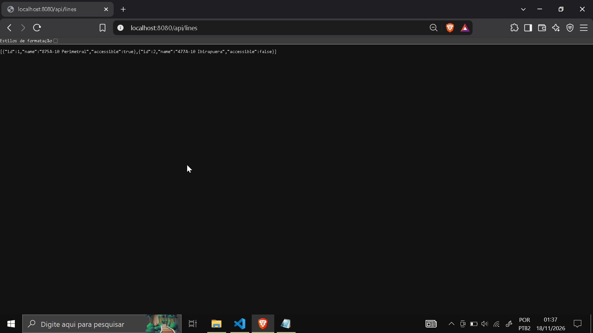
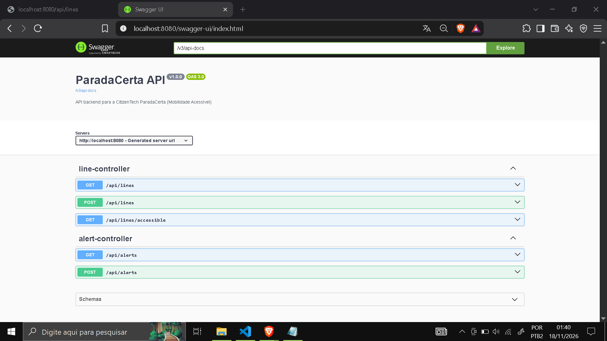
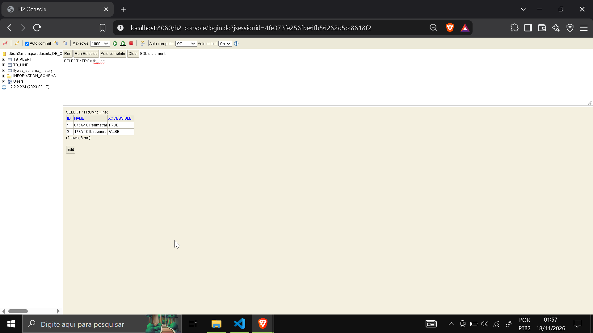
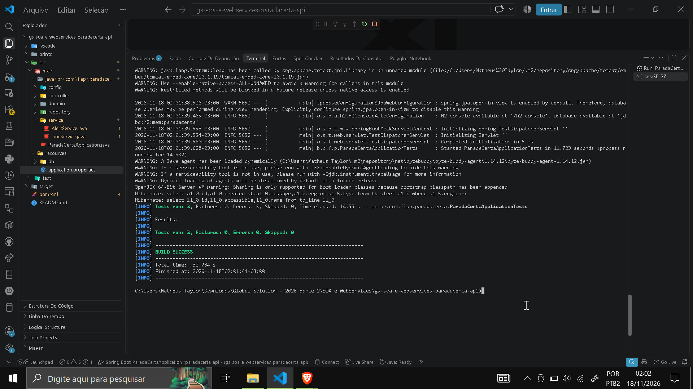

# Global Solution - SOA & Web Services:
# CitizenTech | ParadaCerta API

API REST desenvolvida em **Java 17 e Spring Boot 3** para o projeto CitizenTech **ParadaCerta** da Global Solution do segundo semestre de 2026.
Disciplina: SOA e Web Services — FIAP 2026

---

Integrantes da Equipe (3ESPF):
* Matheus Taylor (RM556211)
* Henrique Maldonado (RM557270) 
* Yuri Silveira (RM557475)

---

## Ficha da CitizenTech

| Campo | Conteúdo |
|---|---|
| **Nome da CitizenTech** | ParadaCerta |
| **Curso/Turma** | FIAP — Engenharia de Software — 3ESPH — Turma da manhã — Global Solution 2º Semestre 2026 |
| **Equipe** | Matheus Taylor RM556211 (Líder); Henrique Maldonado RM557270; Yuri Silveira RM557475 |
| **Cidade e bairro** | São Paulo — Centro (Praça da Sé) |
| **Cidadão beneficiado** | Idosos, pessoas com deficiência e trabalhadores que dependem de ônibus e metrô e não têm informação simples, acessível e confiável sobre rota, acessibilidade, custo de integração e previsão de chegada |
| **Problema, em uma frase** | O cidadão que depende do transporte público em São Paulo perde tempo, segurança e dinheiro porque não encontra informação simples, acessível e confiável sobre qual ônibus/metrô pegar, se o veículo é acessível, quanto custa a integração e quando ele vai chegar. |
| **Como funciona** | O usuário informa origem e destino; o app consulta a API do ParadaCerta; a API integra dados da SPTrans/GTFS/INMET e retorna rota com ônibus/metrô, custo com integração, mapa com veículos em tempo real, filtro “só acessíveis” e favoritos. Um ESP32 consulta a previsão de chegada e aciona alerta físico; em dias de chuva, o sistema também exibe alerta de possível atraso. |
| **O que cada parte faz** | **App Expo:** interface acessível, busca de rota, mapa, filtro acessível e favoritos locais. **API .NET:** domínio, banco, endpoints REST, integração com dados públicos e documentação Swagger. **ML:** estimativa de risco de atraso com dados reais de GTFS, Olho Vivo e INMET. **IoT/ESP32:** alerta físico de chegada e de chuva. **Infra Linux:** provisionamento, systemd, monitoramento e logs. **Cybersecurity:** mapeamento de PII, taint analysis e dashboard de risco ao cidadão. **Testing:** features e casos de teste no Azure Boards. |
| **Indicador de impacto** | Nº de consultas de rota acessível; tempo médio para planejar a viagem; % de alertas de chegada com ETA dentro da margem; nº de dúvidas sobre integração tarifária respondidas; % de rotas exibidas com opção acessível; nº de alertas de chuva/atraso emitidos. |
| **ODS conectados** | **ODS 9** — infraestrutura, inovação e API pública; **ODS 10** — redução das desigualdades no acesso à informação; **ODS 11** — mobilidade urbana acessível e cidades sustentáveis; **ODS 13** — alertas de chuva e adaptação climática. |

## Tecnologias Utilizadas
- **Linguagem:** Java 17
- **Framework:** Spring Boot 3.2.4 (Spring Web, Spring Data JPA)
- **Banco de Dados:** H2 (Desenvolvimento) / PostgreSQL (Produção)
- **Migrações:** Flyway
- **Documentação:** Swagger / OpenAPI (Springdoc)
- **Testes:** JUnit 5 + MockMvc

## Estrutura do Projeto:
```text
gs-soa-e-webservices-paradacerta-api/
├── pom.xml
├── README.md
└── src/
    ├── main/
    │   ├── java/br/com/fiap/paradacerta/
    │   │   ├── ParadaCertaApplication.java
    │   │   ├── config/OpenAPIConfig.java
    │   │   ├── domain/Alert.java
    │   │   ├── domain/Line.java
    │   │   ├── repository/AlertRepository.java
    │   │   ├── repository/LineRepository.java
    │   │   ├── service/AlertService.java
    │   │   ├── service/LineService.java
    │   │   ├── controller/AlertController.java
    │   │   └── controller/LineController.java
    │   └── resources/
    │       ├── application.properties
    │       └── db/migration/V1__create_tables.sql
    └── test/java/br/com/fiap/paradacerta/
        └── ParadaCertaApplicationTests.java
```

## Como Executar no VS Code
1. Abra o VS Code e instale a extensão **Extension Pack for Java**.
2. Clone o repositório: "" e abra a pasta raiz.
3. O VS Code carregará o Maven automaticamente. Aguarde.
4. Para rodar a API, execute no terminal:
   ```bash
   ./mvnw spring-boot:run
   ```
   *(No Windows: `mvnw.cmd spring-boot:run`)*
5. A API estará disponível em: `http://localhost:8080`

## Documentação Automática (Swagger)
Após rodar a aplicação, acesse a documentação interativa dos endpoints:
`http://localhost:8080/swagger-ui.html`

## Console do Banco (H2)
Acesse: `http://localhost:8080/h2-console`
- **JDBC URL:** `jdbc:h2:mem:paradacerta`
- **User:** `sa`
- **Password:** *(vazio)*

## Endpoints Implementados
- `GET /api/lines` — Lista todas as linhas.
- `GET /api/lines/accessible` — Lista apenas linhas com acessibilidade.
- `POST /api/lines` — Cadastra uma nova linha.
- `GET /api/alerts?region={regiao}` — Lista alertas por região (Chuva, Atraso).
- `POST /api/alerts` — Cria um novo alerta.

## Como rodar os testes
```bash
./mvnw test
```
Os testes automatizados validam o carregamento do contexto e as respostas HTTP 200 dos controllers.

## Evidências dos Testes e Eexecução

### Evidência 1 - Execução:



### Evidência 2 - Swagger



### Evidência 3 - H2 Console



### Evidência 4 - Testes

